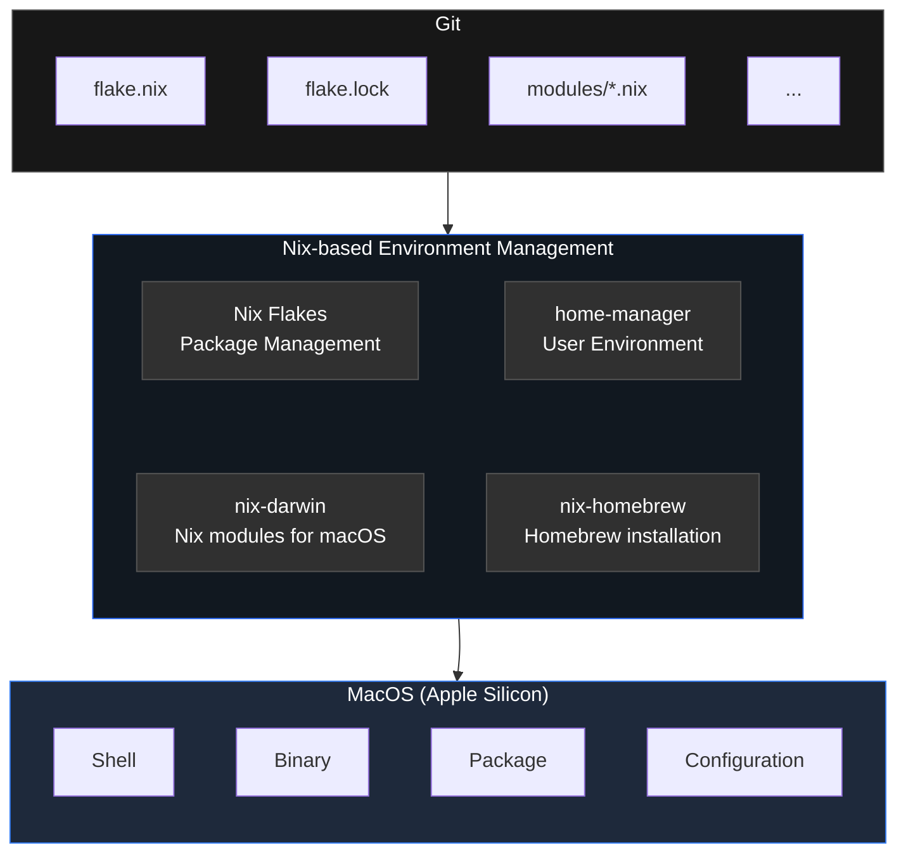

# Mac Flake

Reproducible macOS, powered by Nix Flakes



## Host and User Configuration

Each host is defined in `modules/hosts/<host>.nix` and registered in
`modules/hosts/default.nix`. Customize its host name, platform, account name,
and home directory there. Keep secrets out of the repository and Nix store.

## Quick Start

1. Install Nix [^nix-version]

Refer to [Nix installation guide](https://nixos.org/download.html)

```sh
curl -fsSL https://nixos.org/nix/install | sh
```

2. Enable Nix Flakes [^enable-flakes]

Add the following to your Nix configuration file (usually `~/.config/nix/nix.conf` or `/etc/nix/nix.conf`)

Refer to https://nixos.wiki/wiki/Flakes

```conf
experimental-features = nix-command flakes
```

```bash
# Verify that flakes are enabled
$ nix config show | grep flake
```

3. Add your host-specific configuration in `modules/hosts/<host>.nix` and register it in `modules/hosts/default.nix`.
4. Check and build the configuration

```sh
nix flake check
nix build .#macbook-pro
```

5. Apply changes to your Mac. Replace `<profile>` with the host key from
   `modules/hosts/default.nix` when targeting another host.

```sh
sudo darwin-rebuild switch --flake .#<profile>
```

If it is the first time applying changes, use the below

```sh
sudo ./result/sw/bin/darwin-rebuild switch --flake .#<profile>
```

6. Show current system generation

`/run/current-system` points to the active nix-darwin system generation.
(It is a GC root and is not removed by `nix store gc`.)

```sh
readlink /run/current-system
```

## Configure Mac Flake

The `modules/` directory separates host identity, system configuration, user
packages, shell setup, and managed configuration files.

```text
modules/
├── hosts/       # registered Mac hosts and their identity values
├── configs/     # files linked into the user's home directory
├── pkgs/        # definitions for externally fetched binaries
├── shell/       # shell integration and shell configuration
├── default.nix  # shared nix-darwin system settings
└── home.nix     # Home Manager user configuration and package selection
```

Before applying a host, review and update the following as needed:

- **Host identity:** Add or update `modules/hosts/<host>.nix`, then register
  its key in `modules/hosts/default.nix`. Confirm the macOS hostname,
  platform, user name, and home directory.
- **System settings:** Update `modules/default.nix` for shared nix-darwin
  settings such as the hostname policy or Nix options.
- **User packages:** Update `home.packages` and the external-binary filename
  list in `modules/home.nix`. For a GitHub-release binary, add its URL,
  version, platform source, and hash under `modules/pkgs/`.
- **Shell:** Update `modules/shell/zshrc` for the complete managed `.zshrc`.
  `modules/shell/zsh.nix` links it into the user's home directory.
- **Configuration files:** Add a source file under `modules/configs/` and map
  its destination path in `modules/configs/config.nix`; Home Manager then
  links it into the user's home directory.

After editing, run `nix flake check` and build the intended host before
switching it.

## Cleanup

```sh
# Remove this project's local build-result link.
rm -f result
```

To remove the active Home Manager generation before garbage collection, without
installing the Home Manager CLI globally:

```sh
nix run home-manager/release-26.05 -- uninstall
# or
nix develop .#devTools --command home-manager uninstall
```

A later `darwin-rebuild switch` with this Flake activates Home Manager again.

```sh
# Stop using this project's nix-darwin environment; keeps Nix itself installed.
sudo darwin-uninstaller

# After the uninstaller: inspect the remaining nix-darwin system-profile links.
sudo find /nix/var/nix/profiles -maxdepth 1 -type l -name 'system*' -print

# After verifying they all belong to this retired setup: remove this project's first generation.
sudo rm /nix/var/nix/profiles/system*

# Run garbage collection to remove unreferenced store paths.
nix store gc
# Remove old generations also not referenced by any profile.
nix-collect-garbage -d
```

[^nix-version]: Used Nix 2.35.4 in this project.
